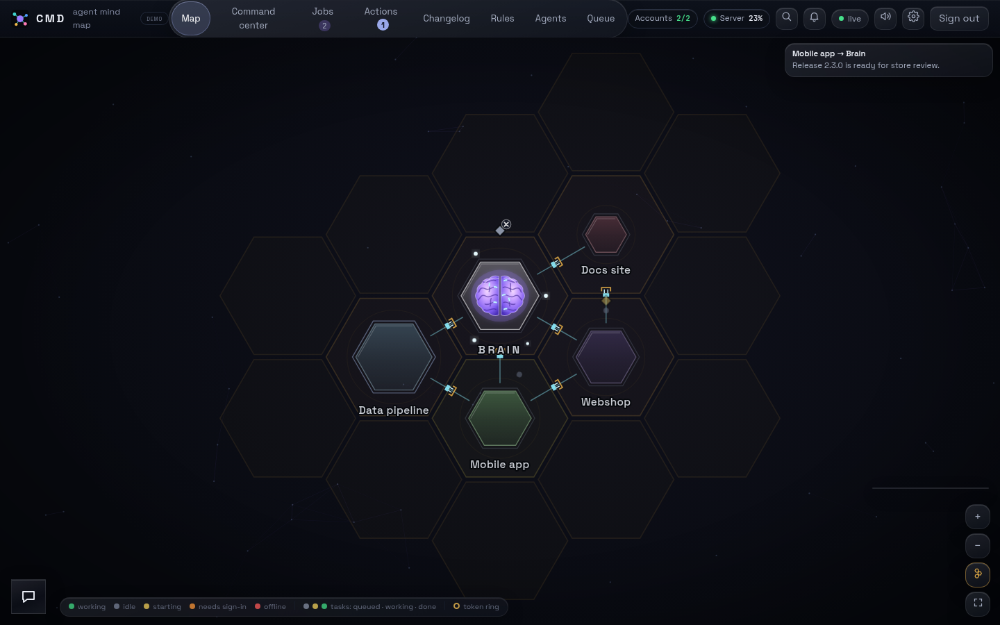
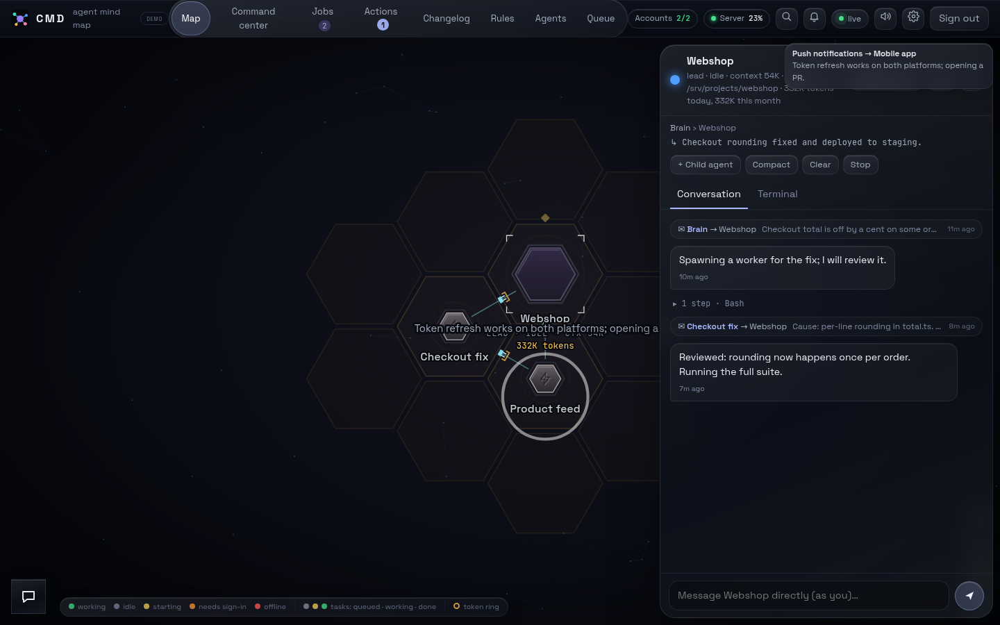
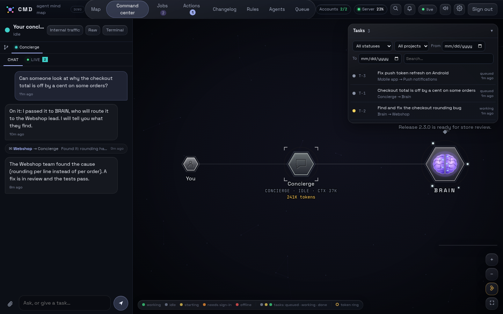
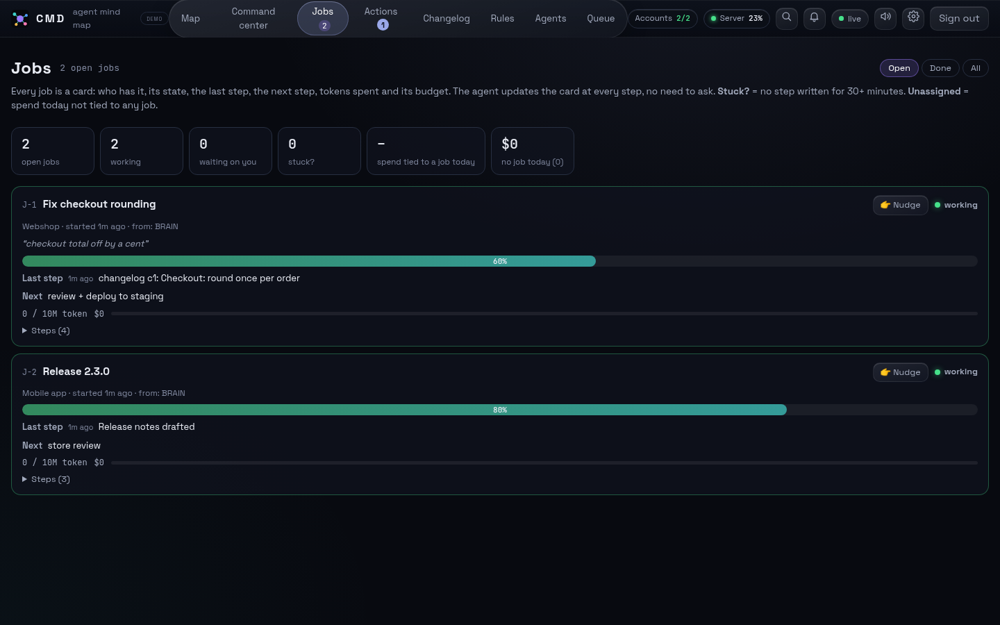
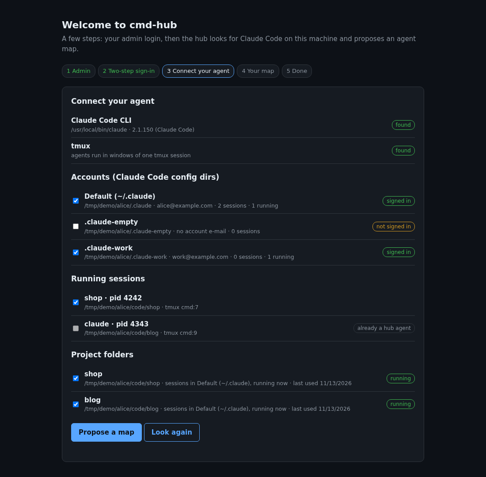
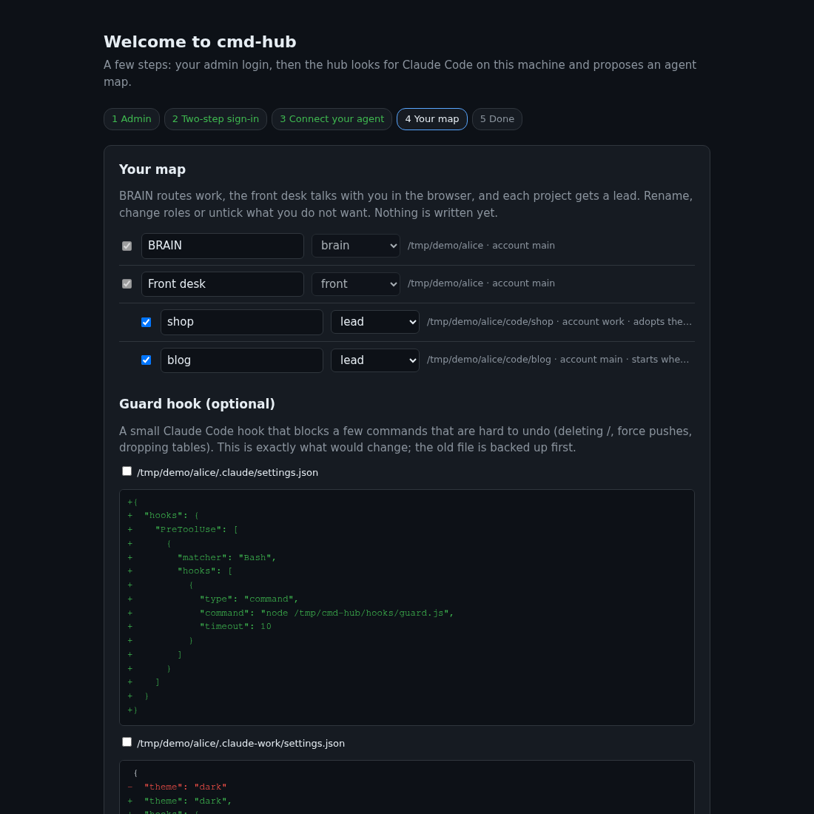

# cmd-hub

A live map and message hub for a team of [Claude Code](https://docs.claude.com/en/docs/claude-code) agents.

Each agent is an ordinary interactive `claude` session in its own tmux window. The hub starts and stops the sessions,
carries messages between them, and draws the whole team as a map in your browser. Agents coordinate with a small `cmd`
command: `cmd spawn`, `cmd send`, `cmd done`, `cmd ask`.

You talk to a **front desk** agent in the browser. It hands real work to **BRAIN**, which routes each piece to the
**lead** of the right project. A lead can start workers of its own.



| | |
|---|---|
|  |  |
|  |  |

*(All screenshots come from demo mode or a test fixture. The agents, people and paths in them are made up.)*

## What it does

- **Map**: every agent with its live state (working, idle, asleep, stopped, needs sign-in), context size, token spend
  and the messages moving between agents.
- **Chat with any agent**: read its conversation, write to it, or open its terminal.
- **Tasks and jobs**: a request from above becomes a task, and the agent's report closes it. A job is a card you
  follow, with its steps, percent done, next step and spend against a budget.
- **Decisions**: an agent asks you a short tick-box question with `cmd ask`. You answer on the card, and the answer
  goes straight back to that agent.
- **Changelog**: every change an agent makes is logged with how to undo it.
- **Rules**: fleet-wide rules you switch on and off. They go into every agent's prompt and, optionally, a managed
  `CLAUDE.md`.
- **Context care**: agents compact themselves, or clear with a handoff note, before a long conversation gets
  expensive. The hub compacts idle agents above a threshold.
- **Load governor**: `heavy -- <command>` queues CPU-heavy jobs. Under pressure, agents that sit idle can be put to
  sleep, and the next message wakes them in the same session.
- **People**: invite teammates by link. Each person gets their own front desk, two-step sign-in and permissions per
  project.
- **Several Claude accounts**: each Claude Code config dir (`~/.claude`, `~/.claude-work`, …) is an account the
  agents can run on.

## Requirements

- Linux. macOS works for everything except detecting already-running sessions, which needs `/proc`.
- Node.js 18.17 or newer. There are no npm dependencies.
- tmux.
- The Claude Code CLI, signed in once (`claude`, then `/login`).

## Install

```sh
git clone <this repo> cmd-hub && cd cmd-hub
npm test            # optional: the test suite, about 2 s
node bin/cmd-hub    # serves http://127.0.0.1:3070
```

Open `http://127.0.0.1:3070`. On the first run you get the setup wizard:

1. **Admin login**: a password, plus optional two-step sign-in (any TOTP app).
2. **Connect your agent**: the hub finds the Claude Code CLI, your config dirs and which ones are signed in, the
   Claude sessions running now (with their tmux pane and folder), and the folders you worked in.
3. **Your map**: a proposed tree with BRAIN on top, a front desk, and one lead per project folder. Running tmux
   sessions are adopted as they are. Rename, change roles or untick anything.
4. **Guard hook (optional)**: the wizard shows the exact `settings.json` diff and asks before writing it. The old
   file is backed up first.
5. **Apply**: the hub writes the config, links `cmd`, `heavy` and `cmd-hub` into `~/.local/bin`, and registers the
   agents.

With no Claude sessions found, you start with BRAIN and a front desk and add projects later.

Prefer a terminal? Run `node bin/cmd init` for the same steps, then `node bin/cmd-hub`.



## Try it without Claude: demo mode

```sh
node bin/cmd-hub --demo       # or: npm run demo
```

This starts a made-up team with fake agents, fake messages and fake token spend. Nothing is read from your machine,
and the data lives in a throwaway temp dir. The demo admin password is printed at start; set
`CMD_HUB_DEMO_PASSWORD` to choose your own.

## The `cmd` command

Agents get `cmd` on their `PATH`, and `CMD_AGENT_ID` tells the hub who is calling. From your own shell you are `you`.

```text
cmd tree                                    every agent, its id, state and parent
cmd spawn --name "API" --role lead --cwd ~/code/api "Own the API project"
cmd send <id|name> "message"                start it with "FYI:" when it only informs
cmd send --urgent <id> "stop"               reaches the agent mid-turn (desks, BRAIN, parents only)
cmd done "what came out (commit, link)"     report the finished task to your parent
cmd tasks | cmd task done T-<n> "result"
cmd job start "Title" | cmd job step "found the cause" --pct 40 --next "fix" | cmd job done "commit abc123"
cmd ask --title "Deploy now?" --q "When :: *Tonight | Now | Next week"
cmd changelog --title "..." --what "..." --revert "..."
cmd park me "waiting for the release" --until 2026-12-01
cmd compact | cmd clear "handoff note" | cmd context
cmd stop|start|restart|remove <id>
```

Run `cmd help` for everything. `heavy -- npm run build` waits for a free heavy-job slot, then runs the build under
`nice`.

## Configuration

One JSON file, `~/.config/cmd-hub/config.json` (or `$CMD_HUB_CONFIG`). Every key is optional.
[`cmd-hub.config.example.json`](cmd-hub.config.example.json) lists them all. The main ones:

| Key | Default | |
|---|---|---|
| `bind`, `port` | `127.0.0.1`, `3070` | where the hub listens |
| `publicUrl` | `""` | when you serve it behind HTTPS: used for invite links, `Secure` cookies and the Origin check |
| `dataDir` | `~/.local/share/cmd-hub` | the tree, tasks, jobs, users, sessions, events |
| `accounts` | `~/.claude` as `main` | Claude Code config dirs the agents may run on |
| `roles` | all `main` | which account runs the front desks, BRAIN and the rest (`fleet`, used in order) |
| `projects` | `[]` | `{ name, cwd, notes }`: one lead per project |
| `tmux.session`, `tmux.socket` | `cmd`, `""` | tmux session for agent windows; `socket` runs them on a separate tmux server |
| `care` | auto compact at 450K | context care thresholds |
| `governor` | `maxHeavy` = cores/4 | heavy-job slots, idle sleep under load |
| `quietHours` | off | a daily window with no agent loops |
| `managedClaudeMd` | `""` | a CLAUDE.md the hub keeps in sync with the Rules tab |
| `mail.mode` | `console` | invite links: `console` (shown to the admin), `smtp` or `sendmail` |

Environment overrides: `CMD_HUB_CONFIG`, `CMD_HUB_DATA`, `CMD_HUB_PORT`, `CMD_HUB_BIND`, `CMD_HUB_PUBLIC_URL`,
`CMD_HUB_TMUX`, `CMD_HUB_CLAUDE_BIN`, `CMD_HUB_DEMO=1`, `CMD_HUB_SMTP_PASS`.

## Security notes

- The hub listens on `127.0.0.1` by default. To reach it from elsewhere, put it behind an HTTPS reverse proxy and set
  `publicUrl`. Do not expose the plain port.
- Agents run as the user who runs the hub. The **terminal** permission gives a person a shell as that user, so grant
  it only to people you would give that shell anyway.
- The agent API (`/internal/*`) is guarded by a random token in `<dataDir>/internal.token`, readable only by the hub's
  user.
- Passwords are hashed with scrypt. Sessions are random tokens in an `HttpOnly`, `SameSite=Strict` cookie. Invite links
  are single use, valid for 48 h, and only their hash is stored. Sign-in, two-step and invite attempts are rate limited.
- The hub never reads Claude credentials. It only checks whether a sign-in exists.
- The optional guard hook (`hooks/guard.js`) blocks a short list of commands that are hard to undo. It is a safety
  net, not a sandbox.

## How it works

```text
bin/cmd-hub        start the hub        src/hub.js           wires the modules together
bin/cmd            the agent CLI        src/agents.js        tree, launch, status, life cycle
bin/heavy          heavy-job queue      src/messaging.js     provenance, delivery, tasks
hooks/guard.js     optional hook        src/claude.js        reads Claude Code session files and transcripts
public/            the browser UI       src/tmux.js          the only place that talks to tmux
src/http/          routes               src/detect.js        "connect your agent"
src/lib/           pure logic (tasks, jobs, rules, quiet hours, …), unit tested
```

API reference: [docs/API.md](docs/API.md).

## Tests

```sh
npm test
```

The suite includes the full first run over HTTP (wizard, detection, proposal, the settings.json diff, apply, sign-in,
an invited member, permissions, the agent API). It runs on a throwaway HOME and a fake `/proc`, with tmux on a private
socket, so no real session or pane is touched.

## License

Not decided yet. See [LICENSE](LICENSE). Third-party files in `public/vendor/` keep their own licenses
(ISC and MIT); see [public/vendor/THIRD-PARTY.md](public/vendor/THIRD-PARTY.md).
